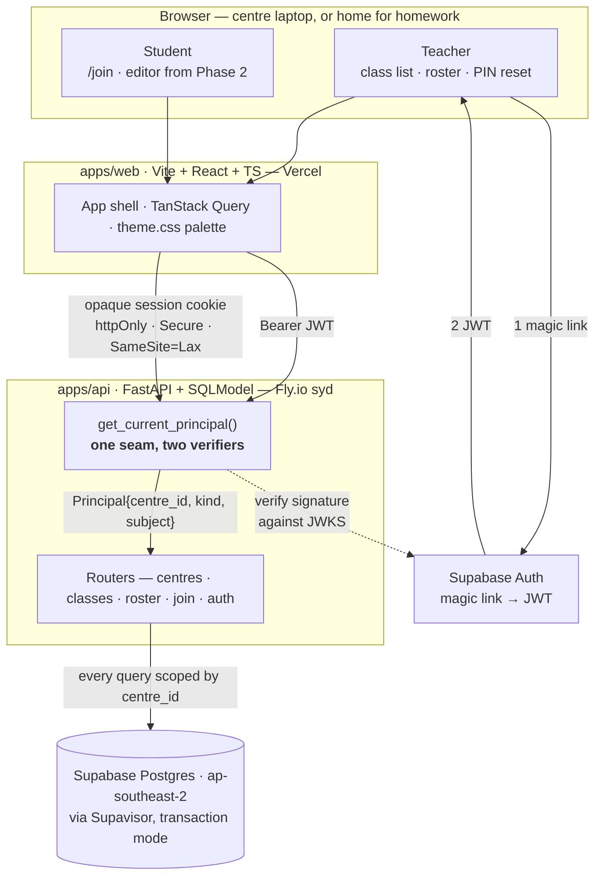
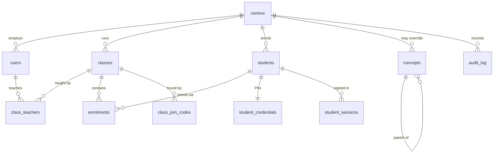

# Coding-teaching-tool

Classroom platform for after-school coding academies with a browser-based Python editor
and per-concept mastery tracking.

The product is specified in [`docs/product-spec.md`](docs/product-spec.md). Phase 1 —
auth, centres, classes and roster — is the current work.

## Layout

```
apps/api/    FastAPI + SQLModel + Alembic, uv-managed
apps/web/    Vite + React + TypeScript + Tailwind v4
docs/        product spec
```

## System architecture

A React app talks to a FastAPI service over plain REST; the service owns a single
Postgres database. There are no microservices, no queues, no Redis and no server-side
code execution — student Python runs in the browser under Pyodide from Phase 2, which
removes sandboxing, resource limits and per-execution cost from the problem entirely.

Everything is hosted in or near Sydney. The data is Australian children's records, and
region is far easier to choose now than to migrate later.



### Two identity models, one authorisation seam

A Year 4 student has no email address and cannot be relied on to remember a password, so
teachers and students authenticate by different routes that converge on one object.

**Teachers** sign in through Supabase Auth by magic link. The browser holds the JWT; the
API verifies it against the project's JWKS endpoint. Sign-in is gated by an email
allowlist in config — without it, anyone who can request a magic link on a public staging
URL would provision a tenant.

**Students** never touch Supabase. A teacher builds the roster, sets each student's PIN
and hands out slips; the student picks their name behind a class join code and enters the
PIN. The API verifies the PIN against an Argon2id hash and mints an opaque session token,
storing only its SHA-256 hash and returning the token as an httpOnly cookie.

The session is opaque rather than a JWT for one reason: **it has to be revocable.** A
teacher kicking a session — wrong child logged in, laptop left signed in — must take
effect on the next request, not whenever a token happens to expire. Two clocks bound it:
12 hours absolute, so a session does not outlive the day on a shared centre laptop, and
90 minutes idle, so an abandoned laptop logs itself out. It still survives a browser
restart mid-lesson.

Both paths resolve into a `Principal` carrying `centre_id`, `kind` and subject id, and
every route authorises against `Principal.centre_id`. That is the tenancy boundary, and
it is the single most important thing in the system: a leak there is a leak of children's
data.

Four digits is a weak secret against the internet and an adequate one against the actual
adversary, a classmate — who also needs a valid class code and a roster entry. Lockout
after five failed attempts, per-IP rate limiting, and rejection of `0000`/`1234`/`1111`/
`1212` carry the rest.

### Data model



A **centre** is the tenancy root. It exists in an MVP serving one class because adding a
tenancy column later means backfilling every table and re-auditing every query.

**Students are not users.** Different identity model, different PII posture, different
lifecycle. Merging them would force nullable `email` and `supabase_user_id` on every row
and muddy every authorisation check. A student carries a display name and nothing else —
no email, no date of birth, no surname where a first name and last initial will do. Data
never collected never has to be protected, disclosed, or deleted.

**A student belongs to a centre, not to a class,** and is enrolled in classes term by
term. This is what lets mastery follow a child across terms in Phase 8. The alternative
resets a child's history every term.

**Nothing is deleted.** `status` columns throughout; withdrawal and archival are state
changes. `audit_log` records teacher actions on children's records — PIN resets, roster
changes, archival — because the Privacy Act makes them worth having and they cannot be
reconstructed afterwards.

**Primary keys are UUIDv7, generated in Python.** Time-sortable, so ids carry creation
order, and client-generatable, which Phase 6's offline event buffer needs: a laptop that
drops off centre wifi mid-lesson must be able to mint non-colliding event ids and flush
them later.

**The concept taxonomy is a table plus a YAML loader, not a hardcoded list.** Next term's
content is unconfirmed, so the content is deferred — but the mechanism is not. Swapping
the taxonomy must be a config edit, not a migration.

### Where development is now

Phase 1 of the plan in `~/Documents/Ken Nguyen/Startup/phase-1-plan.md`, which runs as
eleven steps. Backend is steps 1–8, frontend is 9, and 10–11 ship it.

| Step | | State |
|---|---|---|
| 1 | Scaffold + CI | **Done** |
| 2 | Database, models, first migration | **Done** |
| 3 | Teacher auth — JWKS verification, `Principal`, first-sign-in provisioning | Next |
| 4 | Centre + class CRUD | Not started |
| 5 | Roster management, bulk name entry | Not started |
| 6 | Join codes — 6 chars, unambiguous alphabet, rotate and revoke | Not started |
| 7 | Student PIN login — Argon2id, lockout, rate limiting | Not started |
| 8 | Concepts table + YAML seed loader | Not started |
| 9 | Frontend — four screens in the §8 palette | Not started |
| 10 | Deploy — Supabase `ap-southeast-2`, Fly.io `syd`, Vercel | Not started |
| 11 | Verify the join flow on a real centre laptop | Not started |

**What exists today:** the monorepo, CI, and the eleven tables above as one Alembic
revision that migrates clean from empty and downgrades back. The API serves a health
check and nothing else — there are no routers, no auth code and no screens yet. The
diagram above is therefore the *designed* system; the parts past step 2 are specified but
unbuilt.

**Nothing is deployed.** No Supabase project, Fly app or Vercel project exists. Both
databases are local Postgres 16.

Phases 2–10 in `docs/product-spec.md` §7 add the Pyodide editor, the turtle shim, problems
and test cases, homework marking, event capture, quizzes, mastery and the teacher
dashboard. Phase 5 — homework submit and mark — is the milestone that matters; everything
before it is prerequisite.

## Local development

Requires [uv](https://docs.astral.sh/uv/), Node 22+, and PostgreSQL 16.

```bash
brew install postgresql@16
brew services start postgresql@16
createdb coding_tool_dev
createdb coding_tool_test
```

### API

```bash
cd apps/api
cp .env.example .env
uv sync
uv run alembic upgrade head
uv run uvicorn app.main:app --reload
```

Checks: `uv run ruff check .`, `uv run ruff format --check .`, `uv run pytest`.

The test suite migrates `coding_tool_test` from empty on every run and asserts the
models still match the migrations, so a schema change without a revision fails the
build.

After changing a model:

```bash
uv run alembic revision --autogenerate -m "what changed"
```

Ruff runs over the generated file automatically. Read it before committing —
autogenerate does not always get constraints right.

### Web

```bash
cd apps/web
npm install
npm run dev
```

Checks: `npm run typecheck`, `npm run test`, `npm run build`.

The §8 palette lives in `src/theme.css` as Tailwind theme tokens. One rule from the
spec is load-bearing: **never red for a student's incorrect answer** — amber means "not
yet", sage means correct, and rust is only for system errors.
