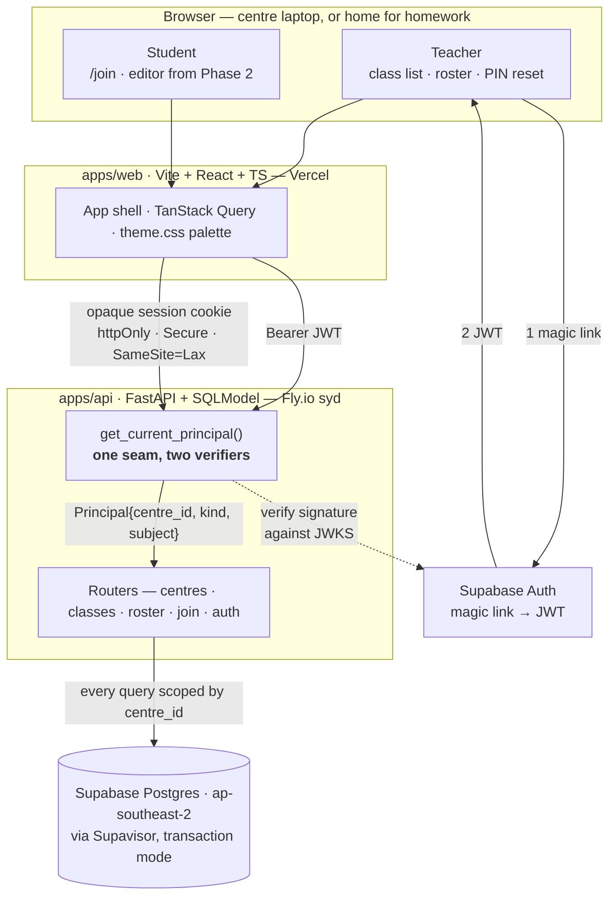
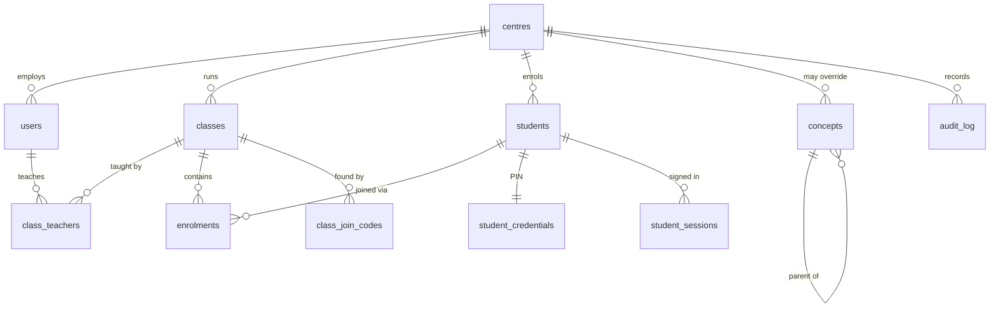

# Coding-teaching-tool

Classroom platform for after-school coding academies with a browser-based Python editor
and per-concept mastery tracking.

The product is specified in [`docs/product-spec.md`](docs/product-spec.md). Phase 1 —
auth, centres, classes and roster — is the current work.

## Layout

```
apps/api/    FastAPI + SQLModel + Alembic, uv-managed
apps/web/    Vite + React + TypeScript + Tailwind v4
docs/        product spec
```

## System architecture

A React app talks to a FastAPI service over plain REST; the service owns a single
Postgres database. There are no microservices, no queues, no Redis and no server-side
code execution — student Python runs in the browser under Pyodide from Phase 2, which
removes sandboxing, resource limits and per-execution cost from the problem entirely.

Everything is hosted in or near Sydney. The data is Australian children's records, and
region is far easier to choose now than to migrate later down the line.



### Two identity models, one authorisation seam

A Year 4 student has no email address and cannot be relied on to remember a password, so
teachers and students authenticate by different routes that converge on one object.

**Teachers** sign in through Supabase Auth by magic link. The browser holds the JWT; the
API verifies it against the project's JWKS endpoint. Only asymmetric algorithms are
accepted — the legacy HS256 shared secret is deliberately not implemented, because
accepting both families is where JWT algorithm-confusion bugs live. The key cache
refreshes on an unknown `kid` as well as on a timer, which is how a key rotation is
picked up without a redeploy, and those refreshes are rate-limited so a forged `kid`
cannot be used to drive traffic at Supabase.

Sign-in is gated by an email allowlist in config — without it, anyone who can request a
magic link on a public staging URL would provision a tenant. The allowlist is checked on
every request rather than only at signup, so removing an address actually revokes access.

**One academy is one centre.** The centre named in config is created by whoever signs in
first, who becomes its owner; every allowlisted teacher after that joins the same centre
as a teacher. A second teacher signing in must never produce a second tenant — they would
silently be unable to see each other's classes, and merging afterwards means moving rows
across the very boundary this design exists to keep intact. Provisioning happens only in
`POST /auth/teacher/session`, called once by the web app after the magic-link callback;
the auth dependency itself never writes.

**Students** never touch Supabase. A teacher builds the roster, sets each student's PIN
and hands out slips; the student picks their name behind a class join code and enters the
PIN. The API verifies the PIN against an Argon2id hash and mints an opaque session token,
storing only its SHA-256 hash and returning the token as an httpOnly cookie.

The session is opaque rather than a JWT for one reason: **it has to be revocable.** A
teacher kicking a session — wrong child logged in, laptop left signed in — must take
effect on the next request, not whenever a token happens to expire. Two clocks bound it:
12 hours absolute, so a session does not outlive the day on a shared centre laptop, and
90 minutes idle, so an abandoned laptop logs itself out. It still survives a browser
restart mid-lesson.

Both paths resolve into a `Principal` carrying `centre_id`, `kind` and subject id, and
every route authorises against `Principal.centre_id`. That is the tenancy boundary, and
it is the single most important thing in the system: a leak there is a leak of children's
data.

Four digits is a weak secret against the internet and an adequate one against the actual
adversary, a classmate — who also needs a valid class code and a roster entry. Lockout
after five failed attempts carries the rest, along with never *generating* an obvious PIN:
`0000`, `1234`, `1111`, `1212`, any run and any repeated pair are excluded from the draw
rather than validated on input, since no human ever types a PIN here.

### Data model



A **centre** is the tenancy root. It exists in an MVP serving one class because adding a
tenancy column later means backfilling every table and re-auditing every query.

**Students are not users.** Different identity model, different PII posture, different
lifecycle. Merging them would force nullable `email` and `supabase_user_id` on every row
and muddy every authorisation check. A student carries a display name and nothing else —
no email, no date of birth, no surname where a first name and last initial will do. Data
never collected never has to be protected, disclosed, or deleted.

**A student belongs to a centre, not to a class,** and is enrolled in classes term by
term. This is what lets mastery follow a child across terms in Phase 8. The alternative
resets a child's history every term.

**Nothing is deleted.** `status` columns throughout; withdrawal and archival are state
changes. `audit_log` records teacher actions on children's records — PIN resets, roster
changes, archival — because the Privacy Act makes them worth having and they cannot be
reconstructed afterwards.

**Primary keys are UUIDv7, generated in Python.** Time-sortable, so ids carry creation
order, and client-generatable, which Phase 6's offline event buffer needs: a laptop that
drops off centre wifi mid-lesson must be able to mint non-colliding event ids and flush
them later.

**The concept taxonomy is a table plus a YAML loader, not a hardcoded list.** Next term's
content is unconfirmed, so the content is deferred — but the mechanism is not. Swapping
the taxonomy must be a config edit, not a migration.

### Where development is now

Phase 1 of the plan in `~/Documents/Ken Nguyen/Startup/phase-1-plan.md`, which runs as
eleven steps. Backend is steps 1–8, frontend is 9, and 10–11 ship it.

| Step | | State |
|---|---|---|
| 1 | Scaffold + CI | **Done** |
| 2 | Database, models, first migration | **Done** |
| 3 | Teacher auth — JWKS verification, `Principal`, first-sign-in provisioning | **Done** |
| 4 | Centre + class CRUD | **Done** |
| 5 | Roster management, bulk name entry | **Done** |
| 6 | Join codes — 6 chars, unambiguous alphabet, rotate | **Done** |
| 7 | Student PIN login — Argon2id, lockout | **Done** |
| 8 | Concepts table + YAML seed loader | **Done** |
| 9 | Frontend — four screens in the §8 palette | **Done** |
| 10 | Deploy — Supabase `ap-southeast-2`, Fly.io `syd`, Vercel | Next |
| 11 | Verify the join flow on a real centre laptop | Not started |

**What exists today:** the whole backend of Phase 1. The monorepo and CI; the eleven
tables as one Alembic revision that migrates clean from empty and downgrades back; teacher
authentication; class CRUD; the roster including bulk paste; join codes; student PIN
sign-in; and the concept taxonomy with its YAML loader. Steps 2–8 needed exactly one
migration between them, because step 2 built every table the phase uses.

**A join code is an attribute of a class, not something a teacher generates.** Creating a
class mints one in the same transaction, so a class can always be joined; it is returned
on the class itself. Rotating replaces it and revokes the old one atomically, and
archiving the class revokes it. There is deliberately no standalone revoke — a class with
children on its roster and no way in is not a state worth being one click away. The
alphabet excludes vowels as well as `0 O 1 I L`: no vowels means a generated code cannot
spell a word, and the rest means it survives being read aloud to a room.

**Teachers issue PINs; students never choose one.** The API generates a PIN, returns it in
plaintext exactly once so it can be printed on a slip, and stores only an Argon2id hash.
A child claiming an unclaimed name on first login would let whoever reaches a laptop first
claim someone else's, and from Phase 8 that means another child's mastery record. One
consequence is worth stating plainly: **a forgotten PIN can only be replaced, never
recovered**, because nobody can read the hash back. That is why issuing PINs across a
class and resetting one child's are both single requests — a Year 4 student forgets theirs
roughly weekly, and a reset flow with friction in it is a reason the tool gets abandoned.

`must_change_pin` exists in the schema and is deliberately never set. Forcing a child to
pick a new PIN after a reset protects a secret from an admin who should not know it, but
here the teacher is *meant* to know it — so it would add a step for a nine-year-old who is
already stuck, and leave the teacher unable to tell them their PIN next time, making the
following reset harder rather than easier.

**One live session per student.** Signing in revokes the others, so an abandoned laptop
stops working the moment that child signs in somewhere else, without a teacher having to
notice. Two clocks bound a session — 12 hours absolute, 90 minutes idle — and it survives
a browser restart mid-lesson.

**There is no per-IP rate limiting, on purpose.** A classroom is twelve children behind one
NAT, several of whom will fumble a PIN in the same minute; a limit tight enough to stop an
attacker is tight enough to lock out the class during a lesson. The per-student lockout —
five attempts, fifteen minutes, in Postgres and therefore correct across processes —
covers the actual threat model, which is a classmate. This gets revisited at step 10, when
whether Fly.io forwards the real client IP is a fact rather than a guess.

Also worth being honest about: against someone holding the database, a 4-digit PIN is
10,000 guesses and Argon2id does not change that. What hashing buys is that a child's
credential never sits in plaintext in a table, a log or a backup. That is the Privacy Act
point, and it is reason enough.

**The concept taxonomy is seeded, and provisional.** `uv run seed-concepts` loads
`src/app/seed/concepts.yaml` — the 18 tags from spec §3.7 — as global concepts with status
`provisional`, because next term's scope and sequence is not confirmed. The loader is
idempotent, only writes rows that actually changed, and archives a key that disappears
from the file rather than deleting it. The shipped list is flat; the loader supports
nesting, which is what makes spec §10's test ("can you configure the product for the VEX
IQ course without changing code?") answerable with a file edit.

**The auth seam is now real on both sides.** A teacher arrives with a Supabase JWT, a
student with an opaque session cookie, and both resolve to a `Principal` carrying
`centre_id`. `/join/lookup` and `/auth/student/session` are the only unauthenticated routes
in the API; what stands in for the tenancy filter there is the join code, and the lookup
returns display names and nothing else.

Every centre-owned lookup still goes through `src/app/scoping.py`; a router that wrote its
own `select(Student)` would be a bug. Stripping the `centre_id` filters out of the roster
helpers fails seven tests and nothing else, and the class and join-code helpers account for
more. Two of those tests exist only to give otherwise-redundant filters teeth — one
hand-writes a cross-centre enrolment no route can create, the other calls a scoping helper
directly with a principal from the wrong centre — because a guard no test notices is a
guard a later refactor deletes.

**The screens exist.** Teacher sign-in by magic link, a class list, a class detail with
roster, bulk paste, join code and PINs, and the student `/join` flow. React Router,
TanStack Query and `@supabase/supabase-js` — the last for teacher auth only, since
students authenticate against our own API.

**The frontend knows the API's shapes rather than guessing them.** `apps/api/openapi.json`
is generated from the Pydantic models by `uv run python -m app.openapi_dump`, committed,
and turned into TypeScript by `npm run api:types`. CI regenerates the JSON and fails on a
diff, so a changed response model breaks the build rather than a screen. None of it
reaches the browser — types are erased at compile time.

**The §8 colour rule is enforced, not remembered.** `Badge` and `Notice` take semantic
tones, `Button` has no danger variant, and tests fail if a wrong PIN ever renders rust.
Every other product on the market colours a wrong password red, so this is the convention
most likely to be broken by reflex.

**Local development runs two servers behind a proxy.** Vite maps `/api` to
`localhost:8000`, so the browser sees one origin and the API needs no CORS middleware —
which keeps CORS a genuine step 10 concern, for when the web app and the API really are
on different domains.

**Nothing is deployed.** No Supabase project, Fly app or Vercel project exists. Both
databases are local Postgres 16.

Phases 2–10 in `docs/product-spec.md` §7 add the Pyodide editor, the turtle shim, problems
and test cases, homework marking, event capture, quizzes, mastery and the teacher
dashboard. Phase 5 — homework submit and mark — is the milestone that matters; everything
before it is prerequisite.

## Local development

Requires [uv](https://docs.astral.sh/uv/), Node 22+, and PostgreSQL 16.

```bash
brew install postgresql@16
brew services start postgresql@16
createdb coding_tool_dev
createdb coding_tool_test
```

### API

```bash
cd apps/api
cp .env.example .env
uv sync
uv run alembic upgrade head
uv run uvicorn app.main:app --reload
```

Checks: `uv run ruff check .`, `uv run ruff format --check .`, `uv run pytest`.

The test suite migrates `coding_tool_test` from empty on every run and asserts the
models still match the migrations, so a schema change without a revision fails the
build.

After changing a model:

```bash
uv run alembic revision --autogenerate -m "what changed"
```

Ruff runs over the generated file automatically. Read it before committing —
autogenerate does not always get constraints right.

### Web

```bash
cd apps/web
cp .env.example .env.local     # fill in the Supabase values
npm install
npm run dev                    # proxies /api to localhost:8000, so run the API too
```

Checks: `npm run lint`, `npm run typecheck`, `npm run test`, `npm run build`.

After changing any API request or response model:

```bash
cd apps/api && uv run python -m app.openapi_dump   # commit the result
cd ../web && npm run api:types                     # commit the result
```

CI fails if either is stale, which is how a backend change that breaks the frontend is
caught by the build rather than by a teacher.

The §8 palette lives in `src/theme.css` as Tailwind theme tokens. One rule from the
spec is load-bearing: **never red for a student's incorrect answer** — amber means "not
yet", sage means correct, and rust is only for system errors.

### Database access

Homebrew's Postgres listens on a local unix socket and trusts the macOS account, so
there is no host, port, user or password to supply. This is also why `.env` carries a
bare `postgresql+asyncpg://localhost/coding_tool_dev` with no credentials in it.

```bash
psql -d coding_tool_dev       # develop against this one
psql -d coding_tool_test      # dropped and re-migrated by every pytest run — keep nothing here
```

Inside `psql`:

| | |
|---|---|
| `\dt` | list tables |
| `\d students` | one table — columns, indexes, CHECK constraints, foreign keys |
| `\di` | indexes |
| `\x` | toggle expanded rows, which makes wide rows readable |
| `\q` | quit |

`\d <table>` is the one that earns its keep: it is how you confirm a migration actually
created the constraint you meant, rather than trusting that autogenerate noticed.

Without opening the shell:

```bash
psql -d coding_tool_dev -c "select * from centres;"
psql -d coding_tool_dev -f script.sql
psql -d coding_tool_dev -tAc "select relname, n_live_tup from pg_stat_user_tables order by relname;"
```

A GUI is worth it once there is real data — TablePlus, Postico and DBeaver all connect
on `localhost:5432`, database `coding_tool_dev`, user is your macOS account, no
password. **Postman is not one of these**: it is an HTTP client and does not speak the
Postgres wire protocol. It is the right tool for the API from step 3 onward, and the
wrong tool for the database.

If the server stops answering:

```bash
brew services list                  # postgresql@16 should read "started"
brew services restart postgresql@16
```

#### On committing this

Documenting local access is not a disclosure. There is nothing secret in it: the
database is a socket on one laptop, reachable only by whoever is already logged into
that laptop, and it holds no data.

Three lines to hold as that stops being true:

- **Credentials never enter the repo.** The Supabase connection string, its password and
  the `service_role` key belong in `apps/api/.env` (gitignored) and in Fly.io and Vercel
  secrets. `.env.example` carries names and empty values only — keep it that way.
- **Direct psql against production bypasses `audit_log`.** That table exists because
  teacher actions on children's records are worth being able to reconstruct. A manual
  `UPDATE` leaves no trace of who did it or why. Prefer reading through the app, and
  when a manual fix is genuinely needed, write down what was run.
- **Production holds children's records.** Under the Privacy Act, a `select *` on
  `students` is a different act from one on `centres`. Pull what a task needs, not the
  table, and do not take extracts off the machine.
