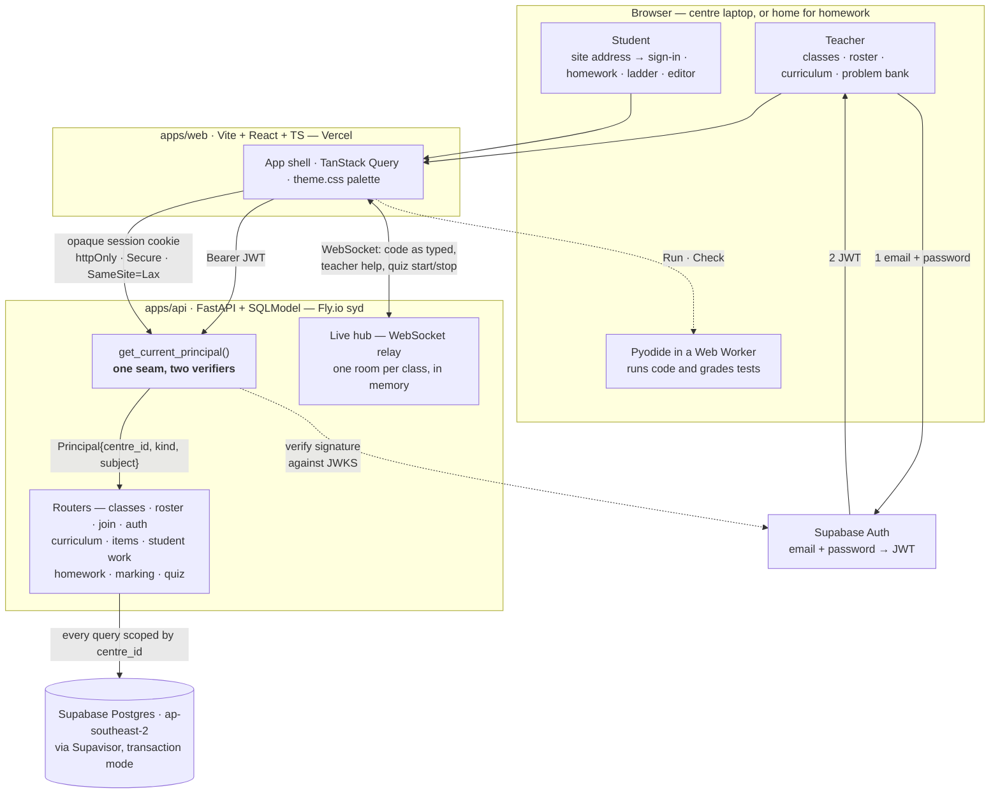
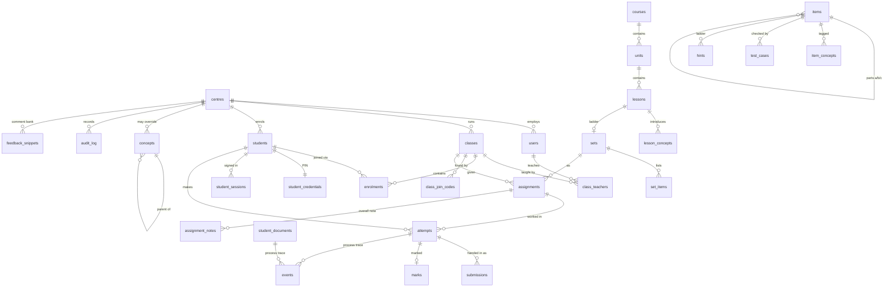

# Yogucode


Yogucode is a classroom platform I'm building for after-school coding academies, live at
<https://yogucode.com>. Its first customer is **Magikid Castle Hill**, where it runs the
Year 4–6 Python class: children write Python in the browser (Pyodide, no server-side
execution), the teacher watches the class live, sets problem sets and timed quizzes, and
sees mastery per concept rather than per score.

Built solo end to end: FastAPI + Postgres on Fly.io and Supabase, React + TypeScript on
the front, with a tested multi-tenant authorisation model for children's data (opaque,
revocable student sessions; row-level security on every table). Shown here as a portfolio
piece — © Ken Nguyen, all rights reserved; no licence is granted to reuse the code.

---

Classroom platform for after-school coding academies with a browser-based Python editor
and per-concept mastery tracking. Lives at <https://yogucode.com>; the brand (cup mark,
`<yogucode>` wordmark, grape/strawberry/lemon/cream, Fredoka) is the "Yogucode Brand"
design system, applied in `apps/web/src/theme.css` and `components/Brand.tsx`.

The product is specified in [`docs/product-spec.md`](docs/product-spec.md). Phase 1 —
auth, centres, classes and roster — is the current work.

## Layout

```
apps/api/    FastAPI + SQLModel + Alembic, uv-managed
apps/web/    Vite + React + TypeScript + Tailwind v4
docs/        product spec
```

## System architecture

A React app talks to a FastAPI service over plain REST, plus one WebSocket per open
page for the live classroom; the service owns a single Postgres database. There are no
microservices, no queues, no Redis and no server-side code execution — student Python runs in the browser under Pyodide from Phase 2, which
removes sandboxing, resource limits and per-execution cost from the problem entirely.

Everything is hosted in or near Sydney. The data is Australian children's records, and
region is far easier to choose now than to migrate later down the line.



### Two identity models, one authorisation seam

A Year 4 student has no email address and cannot be relied on to remember a password, so
teachers and students authenticate by different routes that converge on one object.

**Teachers** sign in through Supabase Auth with an email and a password (since 10 Oct
2026; it replaced the magic link). The browser holds the JWT; the
API verifies it against the project's JWKS endpoint. Only asymmetric algorithms are
accepted — the legacy HS256 shared secret is deliberately not implemented, because
accepting both families is where JWT algorithm-confusion bugs live. The key cache
refreshes on an unknown `kid` as well as on a timer, which is how a key rotation is
picked up without a redeploy, and those refreshes are rate-limited so a forged `kid`
cannot be used to drive traffic at Supabase.

**Teachers join by invitation.** Supabase will create an account for anyone (the anon
key is public), so an account is not a teacher. The owner invites an email on the
**Teachers** page (`teacher_invites`); only an invited address — or one in
`TEACHER_EMAIL_ALLOWLIST`, now just the bootstrap list that lets the first owner in —
provisions a `users` row. Sign-up asks `GET /auth/signup-allowed` first so an uninvited
teacher is told to ask before an email is sent, but provisioning is the real gate. The
teacher verifies their email by link (Supabase "Confirm email" must be on — it is what
proves they own the invited address), and "Forgot password?" emails a reset link. After
that, access is the `users` row, checked on every request: the owner's **Remove**
disables it and the teacher is out on their next click; inviting them again restores the
same profile.

**One academy is one centre.** The centre named in config is created by whoever signs in
first, who becomes its owner; every invited teacher after that joins the same centre
as a teacher. A second teacher signing in must never produce a second tenant — they would
silently be unable to see each other's classes, and merging afterwards means moving rows
across the very boundary this design exists to keep intact. Provisioning happens only in
`POST /auth/teacher/session`, called by the web app at `/auth/callback` after sign-in;
the auth dependency itself never writes.

**Students** never touch Supabase. A teacher builds the roster, sets each student's PIN
and hands out slips; the student types their username and PIN (since 11 Oct 2026;
before that they picked their name behind a class join code). The API verifies the PIN against an Argon2id hash and mints an opaque session token,
storing only its SHA-256 hash and returning the token as an httpOnly cookie.

The session is opaque rather than a JWT for one reason: **it has to be revocable.** A
teacher kicking a session — wrong child logged in, laptop left signed in — must take
effect on the next request, not whenever a token happens to expire. Two clocks bound it:
12 hours absolute, so a session does not outlive the day on a shared centre laptop, and
90 minutes idle, so an abandoned laptop logs itself out. It still survives a browser
restart mid-lesson.

Both paths resolve into a `Principal` carrying `centre_id`, `kind` and subject id, and
every route authorises against `Principal.centre_id`. That is the tenancy boundary, and
it is the single most important thing in the system: a leak there is a leak of children's
data.

Four digits is a weak secret against the internet and an adequate one against the actual
adversary, a classmate — who also needs a valid class code and a roster entry. Lockout
after five failed attempts carries the rest, along with never *generating* an obvious PIN:
`0000`, `1234`, `1111`, `1212`, any run and any repeated pair are excluded from the draw
rather than validated on input, since no human ever types a PIN here.

### Data model



**Everything a child does is an attempt at a tagged problem** (spec §2). A problem is an
**item**; a **set** is an ordered list of them; an **assignment** gives a set to a class as
classwork, homework or (Phase 7) a quiz; an **attempt** is one child's work on one problem
within one assignment. The three surfaces differ only in the assignment's settings, so
the editor, the tests and the mastery data are the same code in every mode.

A **centre** is the tenancy root. It exists in an MVP serving one class because adding a
tenancy column later means backfilling every table and re-auditing every query.

**Students are not users.** Different identity model, different PII posture, different
lifecycle. Merging them would force nullable `email` and `supabase_user_id` on every row
and muddy every authorisation check. A student carries a display name and nothing else —
no email, no date of birth, no surname where a first name and last initial will do. Data
never collected never has to be protected, disclosed, or deleted.

**A student belongs to a centre, not to a class,** and is enrolled in classes term by
term. This is what lets mastery follow a child across terms in Phase 8. The alternative
resets a child's history every term.

**Nothing is deleted.** `status` columns throughout; withdrawal and archival are state
changes. `audit_log` records teacher actions on children's records — PIN resets, roster
changes, archival — because the Privacy Act makes them worth having and they cannot be
reconstructed afterwards.

**Primary keys are UUIDv7, generated in Python.** Time-sortable, so ids carry creation
order, and client-generatable, which Phase 6's offline event buffer needs: a laptop that
drops off centre wifi mid-lesson must be able to mint non-colliding event ids and flush
them later.

**The concept taxonomy is a table plus a YAML loader, not a hardcoded list.** Next term's
content is unconfirmed, so the content is deferred — but the mechanism is not. Swapping
the taxonomy must be a config edit, not a migration.

### Where development is now

**Phase 1 is complete bar its deploy; Phase 2 is built; Phase 3 (turtle) is skipped for
now; Phase 4 is built; Phase 5 steps 7–10 are built.** Phases 4–5 are planned in
`~/Documents/Ken Nguyen/Startup/phase-4-5-plan.md`.

Phase 1's plan lives in `~/Documents/Ken Nguyen/Startup/phase-1-plan.md` and runs as eleven
steps: backend is 1–8, frontend is 9, and 10–11 ship it. Steps 10 and 11 are **deliberately
deferred** to after Phase 3 or 4 and before Phase 5. Deploying earlier bought nothing —
students bring their own laptops, so there is no centre machine to test on, and the first
release to a class is Phase 5 regardless. Doing the infrastructure then also keeps its
surprises away from the week that matters.

| Step | | State |
|---|---|---|
| 1 | Scaffold + CI | **Done** |
| 2 | Database, models, first migration | **Done** |
| 3 | Teacher auth — JWKS verification, `Principal`, first-sign-in provisioning | **Done** |
| 4 | Centre + class CRUD | **Done** |
| 5 | Roster management, bulk name entry | **Done** |
| 6 | Join codes — 6 chars, unambiguous alphabet, rotate | **Done** |
| 7 | Student PIN login — Argon2id, lockout | **Done** |
| 8 | Concepts table + YAML seed loader | **Done** |
| 9 | Frontend — four screens in the §8 palette | **Done** |
| 10 | Deploy — Supabase `ap-southeast-2`, Fly.io `syd`, Vercel | Next |
| 11 | Verify the join flow on a real centre laptop | Not started |

**What exists today:** the whole backend of Phase 1. The monorepo and CI; the eleven
tables as one Alembic revision that migrates clean from empty and downgrades back; teacher
authentication; class CRUD; the roster including bulk paste; join codes; student PIN
sign-in; and the concept taxonomy with its YAML loader. Steps 2–8 needed exactly one
migration between them, because step 2 built every table the phase uses.

**A join code is an attribute of a class, not something a teacher generates.** Creating a
class mints one in the same transaction, so a class can always be joined; it is returned
on the class itself. Rotating replaces it and revokes the old one atomically, and
archiving the class revokes it. There is deliberately no standalone revoke — a class with
children on its roster and no way in is not a state worth being one click away. The
alphabet excludes vowels as well as `0 O 1 I L`: no vowels means a generated code cannot
spell a word, and the rest means it survives being read aloud to a room.

**Teachers issue PINs; students never choose one.** The API generates a PIN and returns it
in plaintext so it can be printed on a slip. Sign-in checks an Argon2id hash; beside it sits
a Fernet-encrypted copy under `PIN_ENCRYPTION_KEYS`, a key the database never holds, so a
teacher can **Show PIN** later — one child per request, audited as `pin.viewed`. A child
claiming an unclaimed name on first login would let whoever reaches a laptop first claim
someone else's, and from Phase 8 that means another child's mastery record. A Year 4
student forgets theirs roughly weekly, which is why looking one up, issuing PINs across a
class and resetting one child's are all single requests — a flow with friction in it is a
reason the tool gets abandoned.

`must_change_pin` exists in the schema and is deliberately never set. Forcing a child to
pick a new PIN after a reset protects a secret from an admin who should not know it, but
here the teacher is *meant* to know it — so it would add a step for a nine-year-old who is
already stuck, and leave the teacher unable to tell them their PIN next time, making the
following reset harder rather than easier.

**One live session per student.** Signing in revokes the others, so an abandoned laptop
stops working the moment that child signs in somewhere else, without a teacher having to
notice. Two clocks bound a session — 12 hours absolute, 90 minutes idle — and it survives
a browser restart mid-lesson.

**There is no per-IP rate limiting, on purpose.** A classroom is twelve children behind one
NAT, several of whom will fumble a PIN in the same minute; a limit tight enough to stop an
attacker is tight enough to lock out the class during a lesson. The per-student lockout —
five attempts, fifteen minutes, in Postgres and therefore correct across processes —
covers the actual threat model, which is a classmate. This gets revisited at step 10, when
whether Fly.io forwards the real client IP is a fact rather than a guess.

Also worth being honest about: against someone holding the database, a 4-digit PIN is
10,000 guesses and Argon2id does not change that. What hashing buys is that a child's
credential never sits in plaintext in a table, a log or a backup. That is the Privacy Act
point, and it is reason enough.

**The concept taxonomy is seeded, and provisional.** `uv run seed-concepts` loads
`src/app/seed/concepts.yaml` — the 18 tags from spec §3.7 — as global concepts with status
`provisional`, because next term's scope and sequence is not confirmed. The loader is
idempotent, only writes rows that actually changed, and archives a key that disappears
from the file rather than deleting it. The shipped list is flat; the loader supports
nesting, which is what makes spec §10's test ("can you configure the product for the VEX
IQ course without changing code?") answerable with a file edit.

**The auth seam is now real on both sides.** A teacher arrives with a Supabase JWT, a
student with an opaque session cookie, and both resolve to a `Principal` carrying
`centre_id`. `/join/lookup` and `/auth/student/session` are the only unauthenticated routes
in the API; what stands in for the tenancy filter there is the join code, and the lookup
returns display names and nothing else.

Every centre-owned lookup still goes through `src/app/scoping.py`; a router that wrote its
own `select(Student)` would be a bug. Stripping the `centre_id` filters out of the roster
helpers fails seven tests and nothing else, and the class and join-code helpers account for
more. Two of those tests exist only to give otherwise-redundant filters teeth — one
hand-writes a cross-centre enrolment no route can create, the other calls a scoping helper
directly with a principal from the wrong centre — because a guard no test notices is a
guard a later refactor deletes.

**The screens exist.** Teacher sign-in by magic link, a class list, a class detail with
roster, bulk paste, join code and PINs, and the student `/join` flow. React Router,
TanStack Query and `@supabase/supabase-js` — the last for teacher auth only, since
students authenticate against our own API.

**The frontend knows the API's shapes rather than guessing them.** `apps/api/openapi.json`
is generated from the Pydantic models by `uv run python -m app.openapi_dump`, committed,
and turned into TypeScript by `npm run api:types`. CI regenerates the JSON and fails on a
diff, so a changed response model breaks the build rather than a screen. None of it
reaches the browser — types are erased at compile time.

**The §8 colour rule is enforced, not remembered.** `Badge` and `Notice` take semantic
tones, `Button` has no danger variant, and tests fail if a wrong PIN ever renders rust.
Every other product on the market colours a wrong password red, so this is the convention
most likely to be broken by reflex.

**Local development runs two servers behind a proxy.** Vite maps `/api` to
`localhost:8000`, so the browser sees one origin and the API needs no CORS middleware —
which keeps CORS a genuine step 10 concern, for when the web app and the API really are
on different domains.

**Phase 2 — the editor — is built.** A student signs in at `/join` and lands in `/work`:
Monaco in a dark theme derived from the §8 palette, Python running in the browser under
Pyodide, a terminal they type into, and their files as tabs that save themselves.

Three things about it are load-bearing and easy to undo by accident:

- **The app is cross-origin isolated.** Pyodide's stdin callback is synchronous, so an
  interactive `input()` from a Web Worker needs `Atomics.wait` on a `SharedArrayBuffer`;
  stopping a runaway `while` loop needs `setInterruptBuffer`, which needs the same. Both
  need `COOP`/`COEP`, which `vite.config.ts` sets and **Vercel will need at step 10**.
  Without them the editor refuses to run rather than hanging on the first `input()`.
- **A Python traceback is amber, never red.** It is a student's mistake, not a system
  error, and §8's rule exists for exactly this moment. Rust is reserved for Pyodide failing
  to load and for a save that failed. Tests enforce it.
- **Monaco is lazy-loaded and Python-only.** `/join` and the teacher screens never fetch
  it. Importing the package root instead of `editor.api` would add ~9 MB of language
  workers for languages nobody teaches here.

Pyodide is self-hosted: ~5.7 MB over the wire, about 68 MB across twelve students at a
first lesson and then cached for a year. Browsers partition the HTTP cache by site now, so
a CDN would have saved nothing and put a third party in the lesson-start path.

**Nothing is deployed.** A Supabase project exists for teacher auth in `ap-southeast-2`,
with an asymmetric ES256 signing key; no Fly app or Vercel project exists, and both
databases are local Postgres 16. Before the first migration runs against Supabase, **turn
its Data API off** — otherwise PostgREST would publish `students` to anyone holding the
publishable key.

**Phase 4 — problems and test cases — is built.** A teacher builds the curriculum
(course → unit → lesson, each lesson listing the concepts it introduces), writes problems
in the bank, puts them on a lesson's ladder, and sets the class's "today's lesson". A child
lands on `/home`, climbs the ladder, and presses **Check** for "3 of 5 passing".

Load-bearing decisions, each easy to undo by accident:

- **Tests run in the browser, in the same Pyodide worker.** `src/runtime/grader.py` runs
  each test in fresh globals, feeds `input()` from the test without capturing its prompt,
  and stops a runaway loop with a per-test deadline from a trace function. It is plain
  stdlib Python, so the API's test suite also runs it under CPython against the starter
  pack (`tests/test_starter_problems.py`). Hidden tests reach the browser — a test cannot
  run without its expected value — which is accepted; the reference solution never does.
- **Publishing needs proof.** The teacher's browser runs every solution against its tests,
  and publish sends the `updated_at` the run was against; a save since then refuses it.
- **A published problem is never edited in place.** "Make changes" opens a new-version
  draft; publishing it marks the old one `superseded`. Ladders and attempts keep the
  version a child actually saw, and a ladder offers the newer version rather than taking it.
- **The server decides hint unlocks** — after N runs or M minutes on the problem, counted
  from the attempt itself, never from the request.
- **Choosing today's lesson opens its ladder as classwork**, one assignment per class per
  ladder, so last week's attempts are still there when the class comes back to a lesson.
- **Problems also arrive as YAML.** Problems → Import previews and then applies a file;
  re-importing is idempotent on each problem's `key`, and nothing is published by import —
  "Check & publish all" in the bank does that. `uv run check-problems FILE` validates a file
  without a database. `src/app/seed/starter-problems.yaml` is eight drafts to review.
- **Teacher problem screens and the attempt page are lazy-loaded**, so `/join` does not
  carry the markdown renderer or the editor modules.

**Phase 5, steps 7–10 — event capture, homework, marking, progress — are built.**

- **Every edit, run, check, error, paste, hint and hand-in is recorded**, on problems and
  on My files (`events`; `src/events/recorder.ts`). Edits are diffs, batched every 3 s,
  flushed with `keepalive` on `pagehide`. Ids are UUIDv7 minted in the browser and inserted
  `ON CONFLICT DO NOTHING`, so a resent batch lands once — Phase 6's offline buffer is a
  client-only change. Nothing reads the trace yet; Phase 7's replay will.
- **Homework is set from the class page** — problems from the bank, a due date and time,
  hints on or off — and appears for the class when the teacher presses Set. A child hands
  in the whole sheet at once, after their browser has checked every problem and shown them
  the result. Late is a flag, never a refusal; handing in again is allowed until the work
  is given back.
- **Marking is one question across the class**, one child at a time, ←/→ saving as it
  goes. Runs and Correct (0–2) are pre-filled from a re-run in the teacher's browser,
  hidden checks included; Approach (0–2) is the teacher's call. A child who never handed in
  is still markable from their saved work. Comments draw on a centre-wide snippet bank;
  there is an optional overall note per child.
- **Nothing reaches a child until "Give back"**, and then only comments and sage/amber per
  question — never the numbers — and the sheet becomes read-only.
- **Progress**: a students × problems grid per homework and for today's ladder (with
  "finished — ready for more"), and a per-child history page with the marks.

**Step 11 — the site address is the student sign-in.** Children type the bare address
(no QR code, by Ken's decision); `/` shows the class code → name → PIN flow, or sends
whoever is already signed in to their own start page. The PIN slips and the class page
print the address to type.

**Live view and quizzes (Phase 10 and Phase 7) are built — before the first deploy, by
Ken's choice.**

- **Live view** (`/classes/:id/live`): a tile per child showing their code keystroke by
  keystroke, with stuck signals (same error ×4, quiet for 5 minutes, a large paste, all
  passing). Click a tile to open it; **Help** lets the teacher type into the child's
  editor while the child types too, each seeing the other's cursor.
- **How it works:** every editor's text is a Yjs document (a CRDT) owned by the child's
  browser. Updates go over a WebSocket to an in-memory hub (`app/live/hub.py`, one room per
  class), which relays them and keeps a log so a teacher arriving late can rebuild them.
  The server never interprets an update, and persistence is still the child's own
  autosave. Our own Monaco↔Yjs binding (`src/collab/monacoBinding.ts`) avoids `y-monaco`,
  which imports the whole Monaco package. A teacher's socket sends its Supabase token as
  the first message; a child's uses the session cookie. Both go through `app.scoping`.
- **Multiple-choice questions**: each wrong option names the misconception it reveals,
  and marking shows how many chose each — "6 chose 'range includes the end'". They mark
  themselves on request.
- **Quizzes**: built from the bank (code and multiple choice), with a length and a Check
  toggle. **Start** switches every child in the class to the quiz at once; while it runs,
  it is the only work a child can open or change (enforced by the server). Autocomplete
  and hints are off, and pastes are flagged on the live view. One clock for the class:
  at the end — or a few seconds after **Stop**, so last keystrokes save — everyone's work
  is handed in automatically, exactly once (a timer, plus finalise-on-read after a
  restart). Marking and giving back are the homework screens.
- **Deploy consequence:** WebSockets cannot go through a Vercel rewrite, and the child's
  SameSite=Lax cookie must reach the socket. So production needs the web app and the API
  on **one registrable domain** (e.g. `app.<domain>` and `api.<domain>`), and the API on
  **one Fly machine** until Redis pub/sub exists.

**Deploy is ready to run (Phase 1 steps 10–11).** One app on Fly.io at
`magikid-code.fly.dev` (Ken's choice, 10 Oct 2026): `app.server:site` serves the built
website and mounts the API under `/api`, so there is one origin — no Vercel, no CORS, no
domain needed (one can be added later). `Dockerfile` and `fly.toml` are at the repo root;
`release_command` migrates Supabase on each deploy. Checked locally in production mode:
`crossOriginIsolated` is true, Python runs, and the live socket connects. Supabase moves
to Pro a day or two before the first real class.

**Deployed (10 Oct 2026)** at <https://magikid-code.fly.dev>: one machine in Sydney,
Supabase migrated to head and seeded with the concept taxonomy. Every table has
row-level security with no policies, so Supabase's public API can read nothing even if
its Data API is switched on. Deploy with
`fly deploy --remote-only --ha=false --build-arg VITE_SUPABASE_URL=… --build-arg VITE_SUPABASE_ANON_KEY=…`.

**Teacher accounts (10 Oct 2026).** Email + password replaced the magic link. Teachers
join by the owner's invite on the Teachers page (`/teachers`), sign up at `/sign-up`
(name, email, password; email verified by link), reset at `/reset-password`. The owner can
cancel invites and remove teachers. No service key on the server: inviting sends no
email — the owner copies the sign-up link to the teacher.

**Permanent student accounts (11 Oct 2026).** Teachers create each child's account on the
class page — a username (suggested from the name) and a PIN (typed or random) — and
children sign in with just those two. PINs stay hashed: shown once on the slip, replaced
with Change PIN if forgotten. Existing students were given usernames and kept their PINs.

**Show PIN (16 Oct 2026).** A teacher can reveal a child's PIN from the roster without the
slip. It is stored encrypted beside the hash under a Fly secret, revealed one child at a
time, hidden again after 30 seconds, and every look is in the audit log. PINs set before
this need one Change PIN to become viewable.

**The desktop (16 Oct 2026).** The page-and-nav-bar UI is replaced, for teachers and
children alike, by a desktop: a top bar (class switcher, Layouts, search on Ctrl/⌘ K), app
windows, and a dock. Teachers' apps are Live, Classes, Files, Code, Work, Marking, Progress
and Library; a child's are Lessons, Code, Files and Work. Every existing page now opens in
the window of the app that owns it (`apps/web/src/desktop/apps.ts`), and the URL is always
the front window's page, so links and Back still work. A teacher's windows open full screen
and can be dragged, resized and snapped; the layout is saved to their account
(`/me/desktop`). A child's windows stay full screen. Files is Finder-style, with a right-click
menu, drag to move, and copy and paste. It lets a teacher open any child's work read-only,
and organise their files: those writes are audited (`/students/{id}/folders|documents`).

**After the first class (11 Oct 2026).** Help now locks the child's editor until the
teacher is done; the owner can **delete entirely** (a child with all their work, or a
class with its work) as well as archive; and My files / My code have **folders** with a
VS Code-style explorer.

**My code (10 Oct 2026).** Teachers have their own private files at `/my-code` to write
and run Python, with a **Present** mode for the projector (full screen, big text).

**Class people (10 Oct 2026).** A class page can remove a child from the class (history
kept, the child signed out; "Show removed students" puts them back) and lists its
teachers as Lead or Assistant. The Classes page shows "My classes" first. Assigning
teachers organises; it does not restrict — every teacher at the centre can still open
every class. **Remove class** archives the whole class: hidden from the list, join code
off, children signed out, everything kept; "Show removed classes" puts it back.

**Rebranded as Yogucode (10 Oct 2026).** Ken's domain is yogucode.com (GoDaddy). The Fly
app keeps its name, `magikid-code` — Fly apps cannot be renamed and nobody sees it once the
domain is on.

### Domain and email

**One address.** `https://yogucode.com` is the app. `www.yogucode.com` and
`magikid-code.fly.dev` answer with a 308 to it (`CanonicalHost` in `app/server.py`, set by
`CANONICAL_HOST` / `REDIRECT_HOSTS` in `fly.toml`). Serving the app on several names would
split sessions: a child's cookie and a teacher's Supabase session each belong to one host.

Connecting the domain, once:

1. `fly ips list -a magikid-code` — note the IPv4 and IPv6 (`fly ips allocate-v6` if
   there is none; a shared IPv4 is fine).
2. `fly certs add yogucode.com -a magikid-code` and `fly certs add www.yogucode.com -a magikid-code`.
3. GoDaddy → yogucode.com → DNS: delete the parked `A @` record and any forwarding, then add
   `A @` → the IPv4, `AAAA @` → the IPv6, `CNAME www` → `magikid-code.fly.dev`, plus any
   `_acme-challenge` CNAME that `fly certs show yogucode.com` asks for.
4. `fly certs check yogucode.com` (and `www.yogucode.com`) until both say Issued.
5. Supabase → Authentication → URL Configuration: Site URL `https://yogucode.com`; add
   `https://yogucode.com/auth/callback` to Redirect URLs (leave the fly.dev one until done).
6. Uncomment `CANONICAL_HOST` / `REDIRECT_HOSTS` in `fly.toml` and deploy.

**Auth email from `no-reply@yogucode.com`, sent by Resend.** No app code: Supabase sends the
emails and Resend is its SMTP server.

1. resend.com → Domains → add `yogucode.com` (region Tokyo, nearest Sydney). Add the DNS
   records it lists in GoDaddy — `MX send`, `TXT send` (SPF), `TXT resend._domainkey`
   (DKIM) — plus `TXT _dmarc` = `v=DMARC1; p=none;`. Verify.
2. Resend → API Keys → create one with *Sending access* for yogucode.com only.
3. Supabase → Authentication → Emails → SMTP Settings: host `smtp.resend.com`, port `465`,
   user `resend`, password = the API key (dashboard only — never the repo or a chat),
   sender `no-reply@yogucode.com`, name `Yogucode`.
4. Supabase → Email Templates: paste `docs/email-templates/confirm-signup.html` into
   "Confirm signup" and `reset-password.html` into "Reset Password"; subjects are in each
   file's comment.

**Supabase settings for password sign-in** (Authentication → Sign In / Providers → Email):
Email provider on, **Confirm email on** (required — without it anyone could sign up with an
invited address they don't own), minimum password length **10**. URL Configuration →
Redirect URLs must include `https://yogucode.com/auth/callback` and
`https://yogucode.com/reset-password`.

Free Resend is 3,000 emails a month, 100 a day.

## Local development

Requires [uv](https://docs.astral.sh/uv/), Node 22+, and PostgreSQL 16.

```bash
brew install postgresql@16
brew services start postgresql@16
createdb coding_tool_dev
createdb coding_tool_test
```

### API

```bash
cd apps/api
cp .env.example .env
uv sync
uv run alembic upgrade head
uv run uvicorn app.main:app --reload
```

Checks: `uv run ruff check .`, `uv run ruff format --check .`, `uv run pytest`.

The test suite migrates `coding_tool_test` from empty on every run and asserts the
models still match the migrations, so a schema change without a revision fails the
build.

After changing a model:

```bash
uv run alembic revision --autogenerate -m "what changed"
```

Ruff runs over the generated file automatically. Read it before committing —
autogenerate does not always get constraints right.

### Web

```bash
cd apps/web
cp .env.example .env.local     # fill in the Supabase values
npm install
npm run dev                    # proxies /api to localhost:8000, so run the API too
```

Checks: `npm run lint`, `npm run typecheck`, `npm run test`, `npm run build`.

After changing any API request or response model:

```bash
cd apps/api && uv run python -m app.openapi_dump   # commit the result
cd ../web && npm run api:types                     # commit the result
```

CI fails if either is stale, which is how a backend change that breaks the frontend is
caught by the build rather than by a teacher.

The §8 palette lives in `src/theme.css` as Tailwind theme tokens. One rule from the
spec is load-bearing: **never red for a student's incorrect answer** — amber means "not
yet", sage means correct, and rust is only for system errors.

### Database access

Homebrew's Postgres listens on a local unix socket and trusts the macOS account, so
there is no host, port, user or password to supply. This is also why `.env` carries a
bare `postgresql+asyncpg://localhost/coding_tool_dev` with no credentials in it.

```bash
psql -d coding_tool_dev       # develop against this one
psql -d coding_tool_test      # dropped and re-migrated by every pytest run — keep nothing here
```

Inside `psql`:

| | |
|---|---|
| `\dt` | list tables |
| `\d students` | one table — columns, indexes, CHECK constraints, foreign keys |
| `\di` | indexes |
| `\x` | toggle expanded rows, which makes wide rows readable |
| `\q` | quit |

`\d <table>` is the one that earns its keep: it is how you confirm a migration actually
created the constraint you meant, rather than trusting that autogenerate noticed.

Without opening the shell:

```bash
psql -d coding_tool_dev -c "select * from centres;"
psql -d coding_tool_dev -f script.sql
psql -d coding_tool_dev -tAc "select relname, n_live_tup from pg_stat_user_tables order by relname;"
```

A GUI is worth it once there is real data — TablePlus, Postico and DBeaver all connect
on `localhost:5432`, database `coding_tool_dev`, user is your macOS account, no
password. **Postman is not one of these**: it is an HTTP client and does not speak the
Postgres wire protocol. It is the right tool for the API from step 3 onward, and the
wrong tool for the database.

If the server stops answering:

```bash
brew services list                  # postgresql@16 should read "started"
brew services restart postgresql@16
```

#### On committing this

Documenting local access is not a disclosure. There is nothing secret in it: the
database is a socket on one laptop, reachable only by whoever is already logged into
that laptop, and it holds no data.

Three lines to hold as that stops being true:

- **Credentials never enter the repo.** The Supabase connection string, its password and
  the `service_role` key belong in `apps/api/.env` (gitignored) and in Fly.io and Vercel
  secrets. `.env.example` carries names and empty values only — keep it that way.
- **Direct psql against production bypasses `audit_log`.** That table exists because
  teacher actions on children's records are worth being able to reconstruct. A manual
  `UPDATE` leaves no trace of who did it or why. Prefer reading through the app, and
  when a manual fix is genuinely needed, write down what was run.
- **Production holds children's records.** Under the Privacy Act, a `select *` on
  `students` is a different act from one on `centres`. Pull what a task needs, not the
  table, and do not take extracts off the machine.
